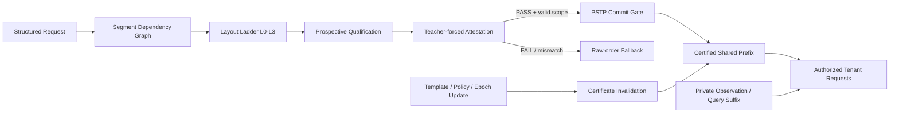

# ContractKV

> **2026-10-15 大修补强第一阶段已完成。** [总报告](docs/tsc_major_revision_phase1_summary_zh.md)汇总原 R1、query 绑定补测、真实长输出、失败案例对照和完整成本；[详细结果](docs/tsc_major_revision_r1r_results_zh.md)保留所有退化与回退。下方 2026-07-20 内容记录原投稿版本，新受控变体的结果单独解释。

> **Certified Prompt Layout Compilation and Transactional Prefix Reuse for Multi-Tenant LLM Services**

ContractKV 是一个面向结构化 LLM 服务的前缀缓存系统。它将 **Prompt 布局编译、行为认证、证书作用域和物理 KV 发布**连接成一个完整闭环，在不修改模型权重和注意力内核的前提下，把原本位于动态片段之后、无法被原生 Prefix Cache 利用的稳定上下文转换为可认证、可共享、可回滚的物理前缀状态。

> 当前论文目标：**IEEE Transactions on Services Computing (TSC)**  
> 当前证据边界：**包含 Qwen / Mistral / Llama / Qwen3-14B 结果与完整 TSC 服务评测；不包含后续 DeepSeek 探索。**  
> 更新时间：**2026-07-20**

---

## 1. 一句话概括

原生 vLLM APC / SGLang RadixAttention 只能复用请求开头连续且 token-identical 的物理前缀。ContractKV 在应用声明的依赖约束内重新组织 Prompt 段，使用模型后端验证候选布局，并只将通过认证的完整稳定 KV blocks 事务化发布到共享缓存。

```text
Structured Prompt
    ↓
Segment Dependency Graph
    ↓
Dependency-valid Layout Ladder
    ↓
Prospective Qualification + Teacher-forced Attestation
    ↓
Scoped Behavioral Certificate
    ↓
Prefix-Selective Transactional Promotion
    ↓
Authorized Physical Prefix Reuse
```

---

## 2. 研究背景与问题

结构化 Agent、RAG、长上下文检索和代码服务通常由多种 Prompt segment 组成：

- system instruction
- retrieved document / repository context
- tool observation
- conversation state
- current user query

其中大部分上下文在多轮请求中保持稳定，但动态 observation 往往位于稳定内容之前或中间，使原生缓存的连续前缀提前终止。

在五类工作流中，我们测得：

| 指标 | 结果 |
|---|---:|
| 平均稳定 token 比例 | **85.0%** |
| 原生 APC 平均恢复比例 | **2.4%** |

因此存在明显的 **structural blind spot**：

> 应用层知道哪些内容稳定，但缓存层只能看到线性的 token 前缀。

直接把稳定内容前移又可能引入三类风险：

1. **Dependency violation**：破坏数据、因果或位置依赖；
2. **Behavioral drift**：依赖合法的重排仍可能改变模型输出；
3. **Shared-state contamination**：失败候选的 KV 若进入共享缓存，会影响后续请求。

---

## 3. 核心方法

### 3.1 Segment Dependency Graph

ContractKV 将结构化请求建模为带稳定性类型的有向无环图：

```text
segment = <id, type, content_hash, token_sequence>
type ∈ {STABLE, MUTABLE, QUERY}
```

依赖边包括：

- **DATA**：数据流依赖；
- **CAUSAL**：时间或轮次依赖；
- **POSITIONAL**：应用声明的位置约束。

候选布局必须是依赖图的合法拓扑序。

### 3.2 Bounded Layout Ladder

系统构造从保守到激进的候选布局阶梯：

- **L0**：raw order；
- **L1 / L2 / L3**：逐步提升被前置的稳定内容比例；
- **L3\***：Qwen / Mistral 使用的完整候选布局。

新模型首先在 source-disjoint development split 上完成 prospective qualification，冻结：

- family maximum level
- eligible descent set
- verification policy hash
- qualification hash

sealed held-out 结果不会反向修改门限或布局。

### 3.3 Scoped Behavioral Certification

依赖合法不等于行为安全。ContractKV 使用与服务路径相同的模型后端，对 raw prompt 与 candidate prompt 执行严格的 teacher-forced token-path attestation：

```text
for every output position:
    top1(candidate | same teacher-forced history)
    ==
    top1(raw | same teacher-forced history)
```

证书绑定版本化作用域：

```text
<model,
 tokenizer/chat-template,
 template version,
 stable-content hash,
 layout hash,
 verification policy,
 qualification hash,
 authorization domain,
 lifecycle epoch>
```

证书是冻结部署范围内的经验行为认证，不是任意自然语言语义等价的形式证明。

### 3.4 Prefix-Selective Transactional Promotion

Candidate KV 在验证期间保持 ephemeral，不进入共享 prefix index。

PASS 后仅发布同时满足以下条件的 KV：

- 位于 stable-prefix boundary 内；
- 位于 attestation-authorized boundary 内；
- 位于 candidate / certified token exact-LCP 内；
- 形成完整物理 block。

FAIL、INCOMPLETE、timeout、duplicate、identity mismatch 或 scope mismatch 均不发布 candidate compiled state，并回退到 raw order。

### 3.5 Service-Template Certificate

同一个已部署 service template 可能被多个 tenant/session 复用。若每个 session 都重新验证，会重复支付相同安全事实的成本。

ContractKV 将证书对象绑定到 immutable service-template version：

- session scope：每个 session 一次完整 attestation；
- template scope：每个 template 一次完整 attestation；
- 每个后续请求只执行 hash、authorization 和 epoch scope check；
- tenant-private observation 和 query suffix 始终隔离。

---

## 4. 系统架构



实现基于：

- vLLM **0.10.2**, V1 scheduler path
- CUDA **12.8**
- PyTorch **2.8.0+cu128**
- 2 × NVIDIA RTX 3090 24 GB
- online ContractKV / PSTP：vLLM
- frozen compiled-layout portability：SGLang 0.4.9

---

## 5. 已完成的主要实验

### 5.1 全工作流、跨模型部署

所有 raw fallback 和未隐藏 verification cost 都计入全局净 TTFT。

| Model | Net mean TTFT ↓ | New-prefill ↓ | Certificate coverage | Quality violations |
|---|---:|---:|---:|---:|
| Qwen3-8B | **37.81%** | **59.13%** | 68% | 0 |
| Qwen3-14B, TP=2 | **44.69%** | **60.57%** | 68% | 0 |
| Mistral-7B-Instruct-v0.3 | **31.72%** | **39.46%** | 50% | 0 |
| Llama-3.1-8B-Instruct | **29.41%** | **30.97%** | 50% | 0 |

> 注意：早期单矩阵中的 Qwen 41.66% 和 Mistral 32.32% 用于负载刻画；论文主跨模型比较采用上表的 fresh-process repeated results。

### 5.2 三模型对称共同 RULER Scope

冻结协议：

- 3 models
- 相同 30 个 RULER sessions
- 10 turns/session
- 3 fresh raw/ContractKV pairs/model
- frozen L3
- 无 requalification、无 threshold tuning
- 5,400 个真实 vLLM requests
- 2,430 对 paired future outputs

| Model | Net mean TTFT ↓ | TTFT speedup | New-prefill ↓ | SLO goodput |
|---|---:|---:|---:|---:|
| Qwen3-8B | **86.64%** | **7.48×** | **96.71%** | **2.61×** |
| Mistral-7B | **87.41%** | **7.94×** | **95.86%** | **3.11×** |
| Llama-3.1-8B | **85.97%** | **7.13×** | **95.45%** | **4.22×** |

模型分层宏平均：

- Net mean TTFT reduction：**86.67%**
- 95% CI：**[86.44%, 86.90%]**
- New-prefill reduction：**96.01%**
- completion：**100%**
- quality violations：**0**
- scope-invalid admissions：**0**

### 5.3 Service-Template 正式任务质量审计

五个真实 deployment templates，每个模板由 10 个授权 tenant 使用 10 turns，三次 paired fresh processes：

- 1,350 对 task-bearing future outputs
- raw score = D2 score = **0.356**
- paired score delta = **0.000 [0.000, 0.000]**
- quality violations = **0**
- unauthorized reuse = **0**
- dynamic-suffix reuse = **0**
- Qasper 按冻结 qualification 执行 raw fallback

未保护的 all-template negative control 在 Qasper 上产生 3 次 metric drop；正式 guarded policy 全部阻止。

### 5.4 Certificate-Object Granularity Ablation

固定相同 Qwen3-8B、25 tenants/template、1,125-request trace、80% load，只改变 certificate granularity：

| Metric | D2-Session | D2-Template |
|---|---:|---:|
| Full verifier calls | 125 | **5** |
| Requests/certificate | 9 | **225** |
| Unhidden verification cost/request | 25.049 ms | **3.236 ms** |
| Prefix-hit ratio | 97.82% | **98.19%** |
| Mean TTFT | 64.0 ms | **62.9 ms** |
| 1500-ms SLO req/s | 0.831 | **0.831** |

核心结论：

- verifier calls 减少 **25×**
- certificate fan-out 提高 **25×**
- 未隐藏验证成本降低 **7.74×**
- layout、prefix work、质量与隔离边界基本不变

### 5.5 Authorized Shared-Service Deployment

25 tenants/template、80% open-loop load：

| Model | Mean TTFT ↓ | p99 ↓ | New-prefill ↓ | 500-ms SLO goodput |
|---|---:|---:|---:|---:|
| Qwen3-8B | **92.62%** | **95.78%** | **98.15%** | **4.81×** |
| Mistral-7B | **54.35%** | **29.65%** | **50.75%** | **4.48×** |

Qwen mean-TTFT reduction 95% CI：**[91.68%, 93.31%]**。

### 5.6 Multi-Tenant Consolidation

40 tenants、100% authorized sharing：

| Metric | Native vLLM APC | ContractKV |
|---|---:|---:|
| Mean TTFT | 1364.5 ms | **90.8 ms** |
| p95 TTFT | 1950.5 ms | **122.7 ms** |
| Steady SLO req/s | 1.064 | **10.984** |
| Jain fairness | 0.666 | **1.000** |
| Unauthorized reuse | 0 | **0** |

80-tenant density：

| Metric | Native APC | ContractKV |
|---|---:|---:|
| SLO-compliant req/s | 1.152 | **11.033** |
| Peak used KV blocks | 530 | **149** |
| Minimum free blocks | 1856 | **2237** |

Peak used blocks 减少约 **71.9%**。当前结果证明系统在测量配置下支持 **at least 80 active tenant identities**，不将 80 声称为最大容量。

### 5.7 Working-Set / Residency Boundary

| Active templates | Arrival | Prefix-hit ratio | Mean TTFT ↓ |
|---:|---|---:|---:|
| 5 | Round-robin | 98.19% | **93.69%** |
| 5 | Zipf | 98.30% | **94.26%** |
| 25 | Round-robin | 0.00% | 0.36% |
| 25 | Zipf | 83.44% | **84.63%** |
| 50 | Round-robin | 0.00% | 0.64% |
| 50 | Zipf | 69.57% | **73.40%** |

ContractKV 的收益需要同时满足：

1. authorized stable sharing；
2. 足够的 certificate fan-out；
3. reusable prefix 在下一次访问时仍保持 resident。

### 5.8 Negative Control

当每个 session 的稳定内容几乎唯一时：

- new-prefill 没有减少；
- Qwen / Mistral 产生约 **1.6%–8.7%** TTFT overhead；
- SLO goodput 不优于 native APC。

因此 ContractKV 不是无条件免费加速器，部署策略应基于 locality、prefix length、fan-out 与 working-set residency。

### 5.9 Safety and Lifecycle

已完成 10 类 lifecycle / scope mutation，结果：

- old certificates invalidated：**PASS**
- old-prefix consumption after mutation：**0**
- unrelated scopes continue serving：**PASS**
- cross-version contamination：**0**
- scope-invalid admission：**0**
- dynamic-suffix reuse：**0**

---

## 6. 当前论文贡献

1. **Structural blind spot formulation**  
   将“应用声明的 byte-stable working set”与“缓存可见的连续 token prefix”之间的错位形式化。

2. **Dependency-valid prompt layout compilation**  
   使用 Segment Dependency Graph 和冻结 candidate ladder，在声明依赖空间内创造可复用物理前缀。

3. **Scoped behavioral certification**  
   将严格 teacher-forced token-path evidence 绑定到 model、tokenizer、template version、policy、qualification、authorization 和 epoch。

4. **Prefix-Selective Transactional Promotion**  
   Candidate KV 在 PASS 前保持不可见，只发布 exact-LCP 内的完整稳定 blocks；失败路径不发布 compiled candidate state。

5. **Service-template certificate**  
   将安全准入对象从 session 提升为 immutable deployment template，在保持 tenant-private suffix 隔离的同时摊销验证成本。

6. **Operating-region characterization**  
   系统性测量 locality、fan-out、working-set residency、tool slack 和负对照，明确方法何时有效、何时应回退 raw order。

---

## 7. 当前状态

### 已完成

- [x] vLLM V1 source-level integration
- [x] Segment Dependency Graph 与布局阶梯
- [x] Prospective qualification 与 frozen manifest
- [x] Compact teacher-forced attestation
- [x] Versioned certificate scope
- [x] PSTP fail-closed publication
- [x] Qwen / Mistral / Llama 跨模型评测
- [x] Qwen3-14B TP=2 scale-up
- [x] 三模型对称共同 RULER 复现
- [x] SGLang frozen-layout portability
- [x] Open-loop SLO service evaluation
- [x] Multi-tenant authorization / fairness / density
- [x] Service-template formal quality audit
- [x] Certificate granularity ablation
- [x] Working-set residency sweep
- [x] Negative control
- [x] Lifecycle invalidation
- [x] TSC service-evaluation extension

### 当前写作与工程任务

- [ ] 对齐论文中的 PSTP/raw APC 可见性语义
- [ ] 完善 CALC candidate construction 与 tie-breaking 描述
- [ ] 统一 SLO deadline、context length、slack 与 output-budget 表
- [ ] 重新审计并更新全部 BibTeX
- [ ] 重绘主文 Figures 1–7
- [ ] 增加控制面微基准：CALC、scope check、metadata commit、invalidation
- [ ] 整理可复现实验入口与 artifact README
- [ ] 可选：代表性 Prompt Cache / CacheBlend 外部 baseline

---

## 8. 重要 Claim Boundaries

- Certificate 是经验行为认证，不是任意语义等价的形式证明。
- 并非所有 model–workflow 都可安全使用激进布局；不合格范围回退 L0/raw。
- Common RULER 结果是完全资格化的共同 scope，不代表所有 workflow 均可使用 L3。
- Full online certificate + PSTP 当前实现在 vLLM；SGLang 结果验证的是 frozen-layout portability。
- 当前原型为单机多 GPU 服务系统，不声称完成分布式 KV-pool transaction。
- “Tenant isolation”特指 unauthorized KV reuse、private suffix 和 certificate-scope 隔离，不涵盖所有网络或侧信道安全属性。
- 服务 open-loop cells 使用 64-token deterministic marker 以隔离 TTFT、queueing 和 prefix reuse；正式任务行为由 full-budget quality experiments 与 1,350-output deployment audit 覆盖。
- 当前 benefit analysis 描述部署 operating region，不声称已有完美的在线经济收益预测器。

---

## 9. 协作建议

新参与者建议先按以下顺序阅读：

1. 本 README；
2. 当前 TSC manuscript；
3. frozen protocol / qualification manifest；
4. service-evaluation closeout；
5. P0-A quality audit 与 P0-B certificate-granularity ablation；
6. vLLM scheduler / certificate / PSTP implementation。

适合并行参与的任务：

- **系统代码审计**：CALC、attestation、PSTP、certificate lifecycle；
- **实验复现**：fresh-process runner、trace commitment、metrics join；
- **论文与代码一致性检查**：公式、变量单位、scope fields、fallback semantics；
- **可视化**：Figures 1–7；
- **参考文献与 Related Work**：Prompt Cache、CacheBlend、SGLang 等；
- **Artifact packaging**：环境、命令、结果表、失败恢复与复现清单。

协作原则：

- 不根据 held-out 结果调整 qualification threshold；
- 不混用早期单矩阵数字与最终 repeated headline；
- partial cells 必须丢弃并完整重跑；
- 每个 fresh-process cell 使用独立 GPU、端口和 compile-cache 目录；
- 任何新 claim 必须能够追溯到冻结协议和机器可读结果；
- 当前 TSC 论文不纳入 DeepSeek 后续探索。

---

## 10. 快速开始

当前推荐环境：

```text
Python / PyTorch: torch 2.8.0+cu128
CUDA: 12.8
Serving engine: vLLM 0.10.2
Primary GPUs: 2 × RTX 3090 24 GB
```

具体安装、数据准备和实验命令应以仓库中的环境文件、runner 和 frozen protocol 为准。请勿在未核对当前 branch 与 manifest hash 的情况下直接复用旧命令。

---

## 11. 当前项目判断

ContractKV 当前已形成完整证据链：

```text
Structural Blind Spot
    → Dependency-valid Layout Compilation
    → Prospective Behavioral Qualification
    → Scoped Runtime Attestation
    → Transactional Physical Publication
    → Service-template Fan-out
    → Open-loop SLO and Multi-tenant Gains
    → Explicit Negative Boundary
```

当前阶段的重点已经从“继续增加实验数量”转为：

> **严格对齐方法、代码、冻结协议、统计口径、图表与论文 claim。**
