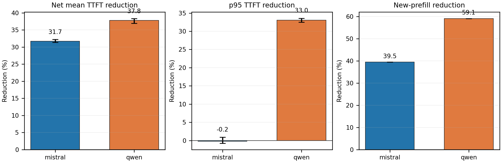

# ContractKV: Verified Transactional Prefix Reuse for Agentic LLM Serving

## Abstract

Agent requests often contain a large stable context interrupted by changing tool observations. Linear prefix caches cannot reuse stable text beyond the first changed token, while unconstrained prompt reordering can silently change model behavior. ContractKV compiles dependency-valid agent prompts into cache-friendly layouts, verifies candidate behavior inside the serving engine, and transactionally publishes only a block-aligned stable prefix under an explicit certificate scope. On vLLM 0.10.2 with Qwen3-8B and Mistral-7B-Instruct-v0.3, three independent fresh-process repetitions at concurrency two show consistent reductions in prefill work and net TTFT after charging unhidden verification cost. A stale-scope Llama failure is repaired by prospective task-family qualification: the qualified held-out path succeeds while every unqualified family fails closed to raw order. ContractKV therefore treats certificate reuse as an empirical, scoped deployment policy rather than a universal semantic guarantee.

## 1. Introduction

Prefix caching is effective when requests repeat a byte- and token-identical prefix. Agent prompts violate this assumption: system instructions, repository context, and retrieved documents are stable, but tool observations and conversation state are inserted between them. The semantic working set is reusable even when its physical linear prefix is not.

Moving stable segments forward can expose this reuse, but creates two correctness hazards. First, segment order can encode dependencies, especially in code and chronological histories. Second, even dependency-valid layouts can change a model's output. Publishing an unverified candidate prefix makes that state visible to later requests. ContractKV addresses all three concerns jointly: a dependency-constrained cache-aware compiler proposes layouts, an in-engine verifier checks an empirical behavior contract, and prefix-selective transactional promotion publishes only the verified, full-block stable region.

This paper makes four contributions. It formulates agent prompt layout as dependency-valid prefix maximization over semantic segments; introduces scoped behavioral certificates that bind model, task, layout, stable content, policy, and observation or qualification state; implements fail-closed transactional prefix publication in the vLLM V1 path; and evaluates the complete path with task-bearing multi-turn traces, physical prefix metrics, fresh-process repetitions, and prospective cross-model qualification.

## 2. Motivation and Problem

Let a request consist of segments with semantic dependency edges. A raw layout preserves arrival order but may place volatile observations before long stable context. The native cache can then reuse only the longest common token prefix. A layout compiler may choose another topological order to increase the stable prefix, but must preserve all dependency edges and remain within a quality budget.

ContractKV optimizes expected prefill work subject to these constraints. The system does not claim arbitrary non-linear KV grafting: it compiles a legal linear prompt and uses the production prefix-cache substrate. The key systems problem is deciding which compiled prefixes may become visible and for how long their empirical attestations remain admissible.

## 3. Design

### 3.1 Dependency-constrained cache-aware compilation

The compiler represents segments as a DAG. Among legal topological orders it favors the order with the greatest overlap with resident stable prefixes, while retaining raw order when no qualified candidate is available. Stable system, schema, document, and repository segments can be grouped ahead of volatile observations only when dependencies permit it.

### 3.2 In-engine compact verification

A candidate is evaluated by the same backend using a frozen teacher-forced strict top-1 contract. The compact response carries the decision, transaction identity, committed-token count, and policy identity rather than a full token-by-token trace. Verification work is scheduled under a declared tool-slack budget; residual time is charged to net TTFT.

### 3.3 Prefix-selective transactional promotion

For block size B, stable-token boundary L_s, and computed boundary L_c, ContractKV publishes

```text
C = B * floor(min(L_s, L_c) / B).
```

Thus no partial block or dynamic suffix is promoted. A non-PASS report, duplicate transaction, timeout, or identity mismatch aborts with zero cache visibility change. Candidate state remains ephemeral until commit.

### 3.4 Scoped certificates

A certificate binds model identity, task family, layout hash, stable-prefix hash, scope mode, observation identity or epoch, policy hash, and qualification hash. Observation-scoped certificates expire when the observation changes. Qualified-session reuse is enabled only for a prospectively frozen model-task-layout qualification. Qualification is an empirical deployment policy, not a proof for arbitrary future inputs. Any mismatch fails closed to raw order.

## 4. Implementation

The prototype targets vLLM 0.10.2 and records physical prefix-hit and new-prefill tokens at the scheduler. The request runner creates identical fresh-process raw-order and ContractKV cells, alternates GPU assignment and launch order, and keeps each cell's process, port, cache state, and metrics log independent. Models and data remain on an 8 TB data volume. The final artifact excludes checkpoints, datasets, raw logs, and exploratory phases.

## 5. Evaluation

### 5.1 Setup

Experiments use one server with two RTX 3090 GPUs. The final repeat contains four cells: raw order and ContractKV for Qwen3-8B and Mistral-7B-Instruct-v0.3. Each cell is repeated three times from a fresh server process at concurrency two over the same sealed ten-turn traces. We report future turns only, include completion, p95, physical new-prefill work, and a 1,500 ms TTFT SLO, and add verification time not hidden by a 2,000 ms tool-slack window.

### 5.2 Fresh-process repeat results

| Model | Net mean TTFT reduction (bootstrap 95% CI) | p95 TTFT reduction | New-prefill reduction | SLO-goodput gain | Scope-invalid admitted |
|---|---:|---:|---:|---:|---:|
| Qwen | 37.81% [36.95%, 38.33%] | 33.03% | 59.13% | 183.24% | 0 |
| Mistral | 31.72% [31.36%, 32.21%] | -0.20% | 39.46% | 26.08% | 0 |

All cells complete only if both policies finish every future request and no scope-invalid certificate is admitted. Figure 1 reports the paired reductions and deterministic 10,000-sample bootstrap intervals over the three independent process repetitions. The intervals quantify run-to-run system variation; three repetitions do not establish population-wide confidence.



### 5.3 External prefix-cache substrate

The B1-B4 matrix uses identical model-specific traces, concurrency, output limits, dtype, and three fresh processes. On SGLang, the offline frozen safe layout reduces mean TTFT versus raw RadixAttention by 54.93% for Qwen and 35.53% for Mistral; p95 changes are 34.66% and 0.07%, respectively. B4 demonstrates compiler-layout portability only: it has no online PSTP or certificate issuance. SGLang prefix-token counters come directly from server logs and include Turn 0; vLLM counters cover future requests only. SGLang physical block IDs remain unavailable rather than inferred from timing.

| Model | Cell | Runtime | Mean TTFT ms | p95 TTFT ms | Input tokens | Prefix-hit tokens | Observed new-prefill total | SLO req/s | Task score | Peak KV |
|---|---|---|---:|---:|---:|---:|---:|---:|---:|---:|
| Qwen | B1 | vLLM-0.10.2-APC | 1396.42 | 2774.37 | 3530.12 | 83.20 | 4653342.00 | 0.41 | 0.39 | 522 blocks |
| Qwen | B3 | vLLM-0.10.2-APC | 633.74 | 1857.91 | 3530.12 | 2121.35 | 1901838.00 | 1.16 | 0.39 | 737 blocks |
| Mistral | B1 | vLLM-0.10.2-APC | 1102.49 | 2200.52 | 2704.52 | 101.12 | 3514590.00 | 0.64 | 0.33 | 397 blocks |
| Mistral | B3 | vLLM-0.10.2-APC | 698.37 | 2204.79 | 2704.52 | 1128.50 | 2127630.00 | 0.81 | 0.33 | 571 blocks |
| Qwen | B2 | SGLang-0.4.9-RadixAttention | 1417.37 | 2921.15 | 3530.12 | 87.26 | 1721438.00 | 0.40 | 0.33 | 12765 token slots |
| Qwen | B4 | SGLang-0.4.9-RadixAttention | 638.80 | 1908.62 | 3530.12 | 1919.55 | 805292.00 | 1.14 | 0.33 | 12765 token slots |
| Mistral | B2 | SGLang-0.4.9-RadixAttention | 1026.23 | 2347.26 | 2704.52 | 118.37 | 1301572.00 | 0.65 | 0.30 | 10229 token slots |
| Mistral | B4 | SGLang-0.4.9-RadixAttention | 661.56 | 2345.64 | 2704.52 | 1042.46 | 839529.00 | 0.87 | 0.31 | 10229 token slots |

### 5.4 Quality and cross-model boundary

The frozen Qwen evaluation certifies 34 of 50 sessions and reports zero unsafe certified sessions, zero dynamic-suffix reuse, and 99.98% stable-prefix physical reuse. The prospectively frozen Mistral split certifies 25 of 50 held-out sessions, completes 450/450 future requests, and reports zero future quality violations and 99.96% certified stable-prefix reuse. These are task-sanity and repository-standard scores, not full benchmark leaderboard claims.

The original Llama run exposed a causal boundary: three sessions became unsafe when an old Turn-0 certificate was reused for changed observations. Rechecking 11 reproducible rows caused fresh verification to reject or remain incomplete on ten; the remaining quality drop did not reproduce. No freshly accepted row remained quality-bad. The corrected prospective result is:

A development-only all-session gate prospectively qualifies `RULER:niah_single_1` and rejects every other Llama task family to raw order. Across 3 fresh-process held-out repeats, the qualified path reduces net mean TTFT by 86.63%, p95 TTFT by 84.51%, and new-prefill work by 95.45%. Fresh paired task scoring covers 270 future outputs with 0 quality violations and 0 scope-invalid admissions. This is empirical cross-model success inside a frozen task-family scope, not universal Llama support.

### 5.5 Physical deduplication

| Agents | Same-snapshot dedup blocks | Dedup KV GiB | Initial alloc raw/Contract | Peak used raw/Contract | Peak-used KV GiB saved | TTFT reduction | Refcount match | OOM-free lower bound |
|---:|---:|---:|---:|---:|---:|---:|---:|---:|
| 10 | 2309.00 | 5.07 | 259.00/3.00 | 1284.00/288.00 | 2.19 | 96.48% | 100.00% | >=20 |
| 20 | 4878.00 | 10.72 | 259.00/3.00 | 1386.00/318.00 | 2.35 | 96.95% | 100.00% | >=20 |

The primary dedup value is measured in one scheduler snapshot as logical shared references minus unique physical block IDs, net of the raw-order cell. Block-pool high-water supplies an independent peak check. Qwen's actual GQA geometry and float16 block size convert blocks to bytes. Cross-lifecycle block-ID reuse is diagnostic only, and new-prefill reduction is never used as a memory proxy.

## 6. Correctness Arguments

Transactional safety follows from publication gating: visibility changes only after PASS, policy identity match, and valid scope. Suffix isolation follows from the block-aligned commit equation. Scope safety is deliberately narrower: `Valid(c, x)` means the empirical attestation may be reused for request x; it does not imply universal semantic equivalence. Fault, duplicate, and mismatch paths abort without publication.

## 7. Related Systems

PagedAttention and vLLM provide the production KV-block and prefix-cache substrate. RadixAttention in SGLang demonstrates a stronger production prefix indexing substrate. ContractKV is orthogonal: it transforms semantically structured agent inputs into dependency-valid reusable prefixes, verifies the behavioral consequence, and controls publication. KV offload, quantization, and compression are compatible lifecycle primitives but are not part of the final main claim.

## 8. Limitations

Certificates are empirical and workload-qualified. Experiments use a single two-GPU RTX 3090 server and controlled agent traces rather than a production cluster trace. Llama success is restricted to the prospectively qualified task family; other families intentionally receive no layout optimization. Verifier coverage limits benefit, and the final artifact does not claim real host KV offload, KV quantization, arbitrary block grafting, or universal model safety.

## 9. Conclusion

ContractKV turns reusable semantic structure into safe physical prefix reuse by combining dependency-valid layout compilation, in-engine verification, scoped certificates, and transactional publication. Positive Qwen, Mistral, and prospectively qualified Llama results establish bounded cross-model transfer; the repaired Llama path shows why the validity boundary must be explicit. The final system claim is strong but disciplined: ContractKV reduces real serving work, physical duplication, and latency inside empirically qualified scopes and preserves raw-order behavior elsewhere.
